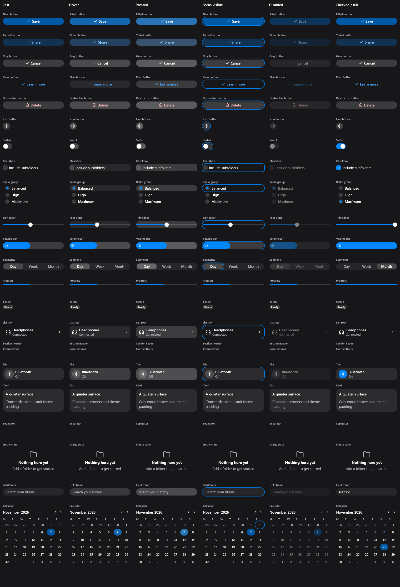

# stillkit

A native Rust UI library for small apps on Windows and Wayland Linux. A macOS backend is in preview for 0.2.
Compose elements and kit components; redraw only what changed, CPU-first, with no UI work while idle.



## Hello

```rust
use stillkit::el::{self, App, El, col, text, token};
use stillkit::{Kind, Scheme, Theme};
fn view(count: &u32) -> El<u32> {
    col().pad(token::PAD).gap(token::GAP)
        .child(text(format!("Hello, stillkit! {count}")))
        .child(text("Click to count").key("count")
            .on_press(|count: &mut u32| *count += 1))
}
fn main() -> anyhow::Result<()> {
    el::run(App {
        title: "Hello",
        size: (360.0, 240.0),
        kind: Kind::App { min: (240, 160) },
        theme: Theme::solid(Scheme::Dark, stillkit::theme::SYSTEM_BLUE),
        state: 0,
        view,
    })
}
```

This exact [example](crates/stillkit/examples/guide_getting_started.rs) builds with the repo. Add anyhow and a pinned git dependency on stillkit; [getting started](docs/guide/getting-started.md) covers the required AccessKit patch; the crates build on stable Rust 1.96 or newer. This is pre-release groundwork; no crates.io release is promised yet.

## Choose a layer

| Crate | When to use it |
| --- | --- |
| stillkit | Native surfaces, declarative el, layout, state/events, motion, text input and agent tooling. Enough for custom UI. |
| stillkit-kit | Ready-made controls, forms, tabs, tables, navigation and overlays. Start here for an app. |
| stillkit-glass | Low-level wgpu Liquid Glass renderer with merging and morphs. For a custom glass host; normal apps use stillkit's Surface hooks and optional gpu feature. |

Try the [settings showcase](crates/stillkit-kit/examples/showcase.rs):

```sh
cargo run -p stillkit-kit --example showcase
cargo run -p stillkit-kit --example showcase -- --snap settings.png --tree settings.json
```

## Platforms and status

0.1 means someone can build a real small app from these docs with el + kit on Windows and Linux, CPU or GPU.

| Platform | Status |
| --- | --- |
| Windows | Full backend: CPU/GPU, native text input/IME, UI Automation. |
| Linux | Wayland, CPU and GPU. AT-SPI on whenever a screen reader is (compile-checked); no X11. GNOME bars require a Shell extension. |
| macOS | **Preview, planned for 0.2.** AppKit/CoreGraphics/CoreText backend, native input, AccessKit and optional Metal; compile-checked only, not yet run on a Mac. |

[Platform notes](docs/guide/platform-notes.md) describe the limits.

## Rendering and costs

Cpu is the default and loads no hardware GPU driver. Gpu is opt-in with stillkit/gpu. Auto chooses CPU unless glass is wanted without an external provider; then it chooses GPU. Modes mix per surface in one process.

Measured Windows popup, 2026-11-07 (private MB):

| Mode | Radeon iGPU | RTX 4070 SUPER |
| --- | ---: | ---: |
| CPU fill | 6.4 | 6.4 |
| GPU without glass | 29.8 | 58.1 |
| CPU + separate glass process, total | 228.4 | 168.5 |
| GPU + in-process glass | 251.8 | 178.3 |

CPU drag frames: 0.282 ms median / 0.662 ms p95. Drivers add idle wakes even when UI draws nothing. Reuse an existing glass host and keep small glass-less surfaces on CPU. These are measurements of one panel, not universal budgets; [conditions and Linux results](docs/ui.md#render-modes).

A Liquid material is a themed fill in el; actual lenses use Surface hooks. [Render modes and glass](docs/guide/render-modes-and-glass.md) explains the distinction.

## Guides

- [stillkit in 10 minutes](docs/guide/ten-minutes.md)
- [component playground and inspector](docs/guide/playground.md)
- [fast iteration and live looks](docs/guide/fast-iteration.md)

- [getting started](docs/guide/getting-started.md)
- [elements and layout](docs/guide/elements-and-layout.md)
- [state and events](docs/guide/state-and-events.md)
- [components](docs/guide/components.md)
- [themes and looks](docs/guide/themes-and-looks.md)
- [motion](docs/guide/motion.md)
- [overlays](docs/guide/overlays.md)
- [text input](docs/guide/text-input.md)
- [render modes and glass](docs/guide/render-modes-and-glass.md)
- [agent tooling](docs/guide/agent-tooling.md)
- [platform notes](docs/guide/platform-notes.md)

Reference: [elements](docs/el.md), [surfaces and measurements](docs/ui.md), [kit](crates/stillkit-kit/README.md), [0.1 plan](plans/ui-library-extraction.html), [changelog](CHANGELOG.md).

## Credits and licence

Extracted from Glaze, a private Windows desktop customizer that still builds on it. Liquid Glass is based on **liquid-rust by al1h3n**, MIT OR Apache-2.0; [retained attribution](crates/stillkit-glass/CREDITS.md). [Lucide](https://lucide.dev) icons are ISC licensed. Bundled [Inter fonts](crates/stillkit/assets/) use the [SIL Open Font License](crates/stillkit/assets/OFL-Inter.txt).

stillkit and stillkit-kit are [MIT](LICENSE); stillkit-glass retains [MIT](crates/stillkit-glass/LICENSE-MIT) OR [Apache-2.0](crates/stillkit-glass/LICENSE-APACHE).
