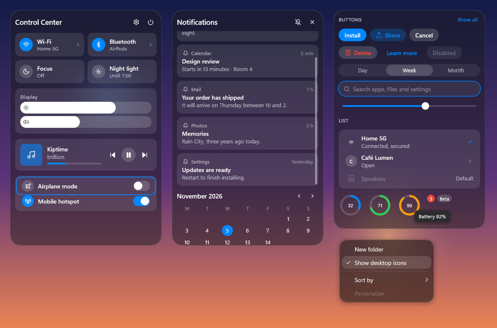

# Native UI: `crates/ui` and `mypaper-shell`

> Written inside mypaper, where this crate was `crates/ui`. The parts on `mypaper-shell` (bars,
> flyouts, the desktop menu, shell measurements) describe how mypaper uses the library; they move
> to mypaper when the docs are split by layer.

The native rebuild (`plans/council/native-plan.md`) draws every shell surface (menus, the top
bar, dock, flyouts and widgets) with one small UI layer, `crates/ui` (`mypaper-ui`), hosted by
one process, `mypaper-shell`. This page is how both work, and what they measured. The flyouts
themselves are in [bars.md](bars.md#flyouts-n3).

## Rules it follows

- **No hardware GPU device in the shell** (plan Rule 1). A process with one pays about 240 MB
  private for the vendor driver stack here. The UI draws with **software Direct2D** into a **WIC
  bitmap** (`D2D1_RENDER_TARGET_TYPE_SOFTWARE`), and text with **DirectWrite**. WARP's DLLs
  (`d3d11`, `dxgi`, `d3d10warp`) are allowed; vendor drivers (`nv*umx`, `nvgpucomp64`, `amdxc64`,
  `atidx*`) never load. A test checks it (`crates/ui/tests/no_gpu_driver.rs`), and the shell logs an
  error if one ever does.
- **If nothing changes, nothing is drawn** (plan Rule 2). A surface redraws only the bounds of
  the paint operations that changed, and an identical frame costs a list comparison. The frame
  ticker runs only while something moves. The shell's loop sleeps in
  `MsgWaitForMultipleObjectsEx` until a message, a scheduled widget tick, or its supervisor's exit wakes it.

## A frame

```text
view(&model, &tokens) ──► DisplayList { ops, hits, focus }
                                   │
Surface::present(ui, origin, size, list)
  1. damage = bounds of the ops that differ from the list on screen   (none: stop)
  2. software Direct2D redraws that rectangle only (clip, clear, ops that touch it)
  3. the rectangle is copied from the WIC bitmap into the window's DIB section
  4. UpdateLayeredWindowIndirect with prcDirty = that rectangle
  5. the accessibility tree follows the hits (only once a client has asked)
```

- **Ops** (`Op`): `Fill`, `Stroke` (rounded or not), `Line`, `Text` (a string or an icon glyph,
  placed by its measured size), `Icon` (a vector icon), `Shadow` (stepped rings), `Arc`, `Image`,
  `TextField`, `Clip`/`Unclip` and `Clipped` (a retained clipped group: scroll views).
- **Hits** (`Hit`): rectangle, id, AccessKit role, label, enabled, checked. Input hit-tests them,
  keyboard focus steps over them (`focus::step`), and assistive technology sees them.
- **Damage** is computed op by op in list order: a changed clock redraws the clock; a moved fill
  redraws where it was and where it is.
- **Text** goes through a cache of `IDWriteTextFormat` and `IDWriteTextLayout`: a label is shaped
  once and redrawn from its layout. Text is grayscale-antialiased with fixed rendering parameters
  (layered windows have alpha, so no ClearType; and golden images must not depend on the machine's
  ClearType tuning). See [The kit › Text](#text) for the parameters and the variable font.
- **Icons**: views name an `icons::Icon`; the theme draws it as a vector or a font glyph. See
  [The kit › Icons](#icons). `icons::centered(text, family, icon, size, rect, color) -> Op` (a
  font glyph) is the older API, kept while surfaces move to `Frame::icon`.
- **Tokens**: [`Theme`](#theme) is the source of truth. `Tokens` (menus) comes from
  `theme.tokens()`; `Colors`, `Ink`, `Step` and `Typeface` below are the older API, kept until
  their users are ported.
- **Type and contrast** shared by the bar, flyouts and widgets: `Typeface` (`system(text)` picks
  Segoe UI Variable Text for small sizes and Display above 20 px; `single(family)` for a theme's
  font) with `style(Step, scale)` or `sized(size, weight, scale)`, where `Step` is the ramp
  (`Micro` 11/500, `Caption` 12/400, `Body` 13/400, `Label` 13/600, `Headline` 15/600, `Title`
  20/600, `Large` 28/500). `Ink::of(text)` gives the contrast steps: `primary`, `secondary`
  (74%), `tertiary` (56%) and `disabled` (34%), the old `--t0..--t3` with the lower two raised.

## The kit

Every surface (bars, flyouts, menus, widgets, Studio) is being rebuilt on one kit:
`mypaper_ui::{theme, kit, layout, scroll, icons}`. A view makes a [`Theme`](#theme), builds its
list with a [`Frame`](#frame-and-components), places things with [layout](#layout), and scrolls
lists with a [`Scroll`](#scroll-view). The gallery renders every component in every style:

```text
cargo run --release -p mypaper-ui --example gallery     # writes docs/media/native/kit-*.png
```

`kit-<style>-<scheme>.png` (liquid, oneui, solid, fluent, mono × dark, light) shows Control
Center, a scrolled notification list, buttons, a segmented control, a field, a slider, list rows,
rings, badges, a tooltip and a menu over a wallpaper with a stand-in for the engine's glass;
`kit-text.png` is the text lab and `kit-icons.png` the icon comparison. All are drawn at 1x and
saved at 2x without smoothing, to show real pixels.



### Theme

`Theme::new(style, scheme, accent)`, with `Style::{Liquid (default), OneUi, Solid, Fluent, Mono}`,
`Scheme::{Dark, Light}`, and the Windows accent (`theme::SYSTEM_BLUE`, iOS 26's `#0088FF`, when
there is none). Values are design px; `Frame` scales them.

| Field | What |
|---|---|
| `color: Palette` | `label`, `secondary`, `tertiary`, `quaternary` (disabled); `fill` (a control's rest: an off switch, a track, a gray button), `card` (cards, tiles), `well` (fields, a segmented track); `separator`; `accent`, `on_accent`, `accent_wash`; `destructive`, `success`, `warning`; `surface` (a glassless body, and the glass tint), `elevated` (tooltips); `hover`, `pressed` (washes); `knob`, `scrollbar`, `shadow` |
| `font: TypeRamp` | `style(TextRole, s) -> TextStyle`, `line(role, s)` |
| `metrics` | `pad` (panel inset), `gap` (between blocks), `item`, `row` (two lines), `row_single`, `control`, `control_small`, `icon`, `icon_small`, `icon_large`, `hit`, `scrollbar`, `scrollbar_inset` |
| `radius` | `surface`; `card` = surface − pad (concentric, `Radii::concentric(outer, inset, min)`); `control: Option<f32>` (`None`: capsules); `small` |
| `motion` | Apple springs (`Spring::apple(duration, bounce)`): `interactive` (0.15, 0.14), `open` (0.3, 0.12), `layout` (`.snappy`), `scroll` (0.22, 0); `scrollbar_idle` 0.9 s, `scrollbar_fade` 0.35 s |
| `icons`, `icon_weight` | `IconSet::Vector` (Fluent: `IconSet::Font`), stroke per 24 units |
| `glass`, `border` | engine glass material (`None` for Solid and Mono); Solid's one hairline |

- **Contrast on glass.** The label steps sit above Apple's (whose vibrancy blend a layered window
  can't do): dark 100/72/50/30 %, light 88/78/60/34 % (Fluent uses Windows 11's text steps). A test
  holds every style and scheme to label 7:1 (the AAA target liquid-rust uses on large light
  glass), secondary 4.5:1 (also on cards), tertiary 3:1 and accent 3:1 over its own surface; the
  accent is lightened or darkened until it reaches 3:1.
- **Adaptive light/dark** (liquid-rust's rule from Apple's kit): `theme.adaptive(min_side,
  backdrop_luminance) -> Scheme`. Glass smaller than about 180 pt (buttons, a bar, a small widget)
  takes the face that reads over what is behind it (flip at WCAG luminance 0.179); panels and
  menus follow the scheme. `theme.with_scheme(scheme)` gives the flipped theme. The engine has to
  report the backdrop's luminance for this to switch live; until then the scheme rules.
- `theme.tokens()` gives menus their `Tokens`; `theme.ink()` the older `Ink`;
  `theme::{luminance, contrast, over}` are the WCAG helpers the tests use.

| `TextRole` | liquid, solid, mono | oneui | fluent |
|---|---|---|---|
| `LargeTitle` | 28 / 700, −0.6 | 30 / 700 | 28 / 600 |
| `Title1` | 22 / 700, −0.4 | 23 / 700 | 20 / 600 |
| `Title2` (panel titles) | 17 / 600, −0.2 | 18 / 700 | 16 / 600 |
| `Title3` | 15 / 600 | 16 / 700 | 14 / 600 |
| `Headline` (row titles) | 14 / 600 | 15 / 600 | 14 / 600 |
| `Body` | 14 / 400 | 15 / 400 | 14 / 400 |
| `Callout` (subtitles) | 13 / 400 | 13 / 400 | 13 / 400 |
| `Subheadline` (section headers) | 12 / 600 | 12 / 600 | 12 / 600 |
| `Footnote` (timestamps) | 12 / 400 | 12 / 400 | 12 / 400 |
| `Caption` (badges) | 11 / 500 | 11 / 600 | 11 / 400 |

Size / weight, tracking in px. Body is 14, not macOS's 13: grayscale text at 96 DPI needs the
extra pixel.

### Text

- **Segoe UI Variable through its axes.** The ramp's family is `VARIABLE` ("Segoe UI Variable"):
  `IDWriteFactory6::CreateTextFormat` with `wght` = the weight (500 is a real medium, not 400 or
  600) and `opsz` = the design size in points, as Windows 11 draws it. `TextStyle` gained
  `tracking` (device px, applied with `SetCharacterSpacing`) and `optical` (points; 0 takes it from
  the size). Other families keep their named faces.
- **Rasterization** (`TextQuality`, `Ui::set_text_quality`): grayscale, gamma 1.8, grayscale
  enhanced contrast 1.0, natural symmetric, vertical grid fit. The old parameters put contrast 0.5
  in the ClearType-only field of a v1 `IDWriteRenderingParams`, so grayscale text got DirectWrite's
  weakest coverage: light text on glass read thin and grey. `kit-text.png` shows before, after,
  contrast 1.5, gamma 2.2 and GDI classic on dark and light glass; 1.0 is Windows' own grayscale
  default and was the clearest without bloating. Colour fonts are on
  (`D2D1_DRAW_TEXT_OPTIONS_ENABLE_COLOR_FONT`): emoji in notifications draw in colour.
- **Pixels.** Components put text on whole pixels and centre it in the role's line height.

### Icons

`Icon` names (media, chevrons, commands, shell, status with levels, weather): `Play`, `Pause`,
`Previous`, `Next`, `Shuffle`, `Repeat`, `ChevronLeft/Right/Up/Down`, `Add`, `Remove`, `Close`,
`Check`, `More`, `Settings`, `Search`, `Edit`, `Delete`, `Copy`, `Refresh`, `Pin`, `Grip`,
`External`, `Download`, `Upload`, `Apps`, `Window`, `Power`, `Restart`, `SignOut`, `Lock`, `Bell`,
`BellOff`, `Calendar`, `Clock`, `Timer`, `Globe`, `Keyboard`, `Desktop`, `Home`, `User`, `Folder`,
`File`, `Clipboard`, `Terminal`, `Message`, `Controls`, `Layers`, `Volume(0..=3)`, `Mute`,
`Speaker`, `Headphones`, `Mic`, `Wifi(0..=3)`, `Ethernet`, `Offline`, `Hotspot`, `Cast`,
`Airplane`, `Location`, `Bluetooth`, `Brightness`, `Moon`, `NightLight`, `Focus`, `Saver`, `Gauge`,
`Thermometer`, `Cpu`, `Battery(0..=10)`, `Charging`, `BatteryWarning`, `Plug`, `Accessibility`,
`Eye`, `Camera`, `Info`, `Warning`, `Star`, `Heart`, `Notes`, `Tasks`, `Photo`, `Feed`, `Sun`,
`Cloud`, `CloudSun`, `CloudMoon`, `Rain`, `Drizzle`, `Snow`, `Snowflake`, `Thunder`, `Fog`,
`Wind`, `Droplet`, `Umbrella`, `Sunrise`, `Sunset`.

- **Vectors** (every style but Fluent): Lucide's outlines (ISC licence,
  `crates/ui/icons/LICENSE-lucide`), compiled in as SVG path data (`src/icon_paths.rs`), parsed
  once into Direct2D geometry per canvas and drawn as `Op::Icon { rect, icon, weight, color }`:
  round caps and joins, 1.75 units per 24 (SF Symbols' calm weight), never under 1.35 px. Media
  glyphs are filled as well, like SF's `.fill`. Chosen over the font after rendering both
  (`kit-icons.png`): Lucide reads like SF Symbols and covers weather; at 13 px the hinted font is
  a little crisper, so the kit draws row and button glyphs at 14 px and up.
- **Font** (Fluent): Segoe Fluent Icons glyphs (`Icon::font_glyph`); icons the font lacks are
  vectors there too.
- **Adding an icon:** add its Lucide name to `crates/ui/icons/gen.mjs`, run
  `bun crates/ui/icons/gen.mjs <lucide-static>/icons`, then add the variant and its `lucide()` arm.

### Frame and components

`Frame::new(&mut ui.text, &theme, s, &interaction)` builds one `DisplayList` (`f.list`). Lengths
in calls are **device px** (`f.px(design)` converts); `f.font(role)`, `f.line(role)`.

| Call | Draws |
|---|---|
| `surface(rect, glass_available) -> Option<Glass>` | the body, first: with glass only an invisible hit fill, and the `Glass` to hand to `Surface::set_glass`; without, the surface fill (and Solid's hairline) |
| `card(rect) -> inner` | the card fill at the concentric radius; returns the rect inset by `pad` |
| `separator(left, right, y)` | a hairline |
| `label(x, y, text, role, color, max)`, `text_in(rect, text, role, color, Align)`, `paragraph(x, y, w, text, role, color, lines) -> h`, `line_count(..)` | text, cut with an ellipsis, wrapped on the role's line height |
| `icon(rect, Icon, size, color)` | the theme's icon, centred |
| `button(id, rect, label, Option<Icon>, ButtonKind, enabled)`, `button_size(label, icon)` | `Filled` (the one primary), `Tinted`, `Gray`, `Plain`, `Destructive` |
| `icon_button(id, rect, Icon, size, label, filled)` | a round button; `filled` keeps the control fill at rest (media) |
| `switch(id, right, center_y, on, label, enabled) -> Rect` | an on/off switch, knob with a soft shadow |
| `slider(id, rect, value, label, Option<Icon>)` | with an icon, Control Center's thick bar; without, a thin track and knob. The hit's label ends in the percent |
| `segmented(base, rect, labels, selected)` | segment `i` is hit `base + i` |
| `row(&Row, rect)`, `row_height(&Row)` | `Row { id, lead: Lead::{None, Icon, Badge(icon, on), Image, Monogram}, title, subtitle, accessory: Accessory::{None, Chevron, Check, Text, Switch(on), Button(id, icon, label)}, selected, enabled }` |
| `section_header(rect, title, Option<(id, action)>)` | a small title and a plain action |
| `tile(&Tile, rect)` | `Tile { id, icon, title, subtitle, on, enabled, more: Option<id> }`: Control Center's toggle tile |
| `progress(rect, value, color)`, `ring(center, radius, width, value, color)`, `badge(x, center_y, text, color) -> w` | meters and counts |
| `tooltip(anchor, text, bounds) -> Rect` | on the elevated fill, below or above its anchor |
| `field_frame(rect, placeholder, empty, focused, icon) -> inner` | a field's well, placeholder and focus ring; the `Op::TextField` goes in `inner` |
| `empty(rect, icon, title, detail) -> h` | a centred message where a list would be |
| `scroll(viewport, &scroll, now, \|f, origin\| -> content_height)` | see [Scroll view](#scroll-view) |
| `wash(id, rect, radius, enabled)`, `focus_ring(id, rect, radius)`, `hit(..)`, `fill(..)`, `push(op)` | the parts, for custom controls |

- **States** come from `interact::Interaction` (`hover`, `pressed`, `focus`, `focus_visible`).
  Each control's wash and focus ring are always in the list, transparent at rest: a hover changes
  one op and never shifts the rest of the list (a test checks it), so damage stays one control.
- **No outlines.** Nothing draws a border except Solid's surface hairline. Focus rings appear
  only after the keyboard moved focus (`focus_visible`), never on a click (tested).
- Hit id `kit::NONE` (0) draws without a hit (decoration).

### Layout

- `Rect::take_top/take_bottom/take_left/take_right(size, gap) -> (piece, rest)`,
  `inset(Insets::all(v) | Insets::xy(x, y))`, `place(w, h, Align, Align)` (whole pixels),
  `intersect`, `center`.
- `Stack::column(rect, gap)` / `Stack::row`: `next(size) -> Rect`, `space(extra)`, `rest()`,
  `used()` (the content's extent).
- `layout::split(rect, Axis, gap, &[Length::Fixed(px) | Length::Fill(weight)], &mut out)`,
  `layout::grid(rect, columns, gap, row_height, index) -> Rect`.
- `SizeClass::of(width, height)`: `Compact` (< 150 design px on the smaller side), `Regular`
  (< 300), `Large`, so widgets switch layouts by size.

### Scroll view

`Scroll` is the state, kept by the panel: `Scroll::new(&theme.motion)`.

- `f.scroll(viewport, &scroll, now, |f, origin| { ...draw from origin...; content_height })`
  draws the content as one `Op::Clipped` group in the viewport, cuts its hits to the viewport and
  drops those outside, and draws the overlay scrollbar inside the viewport's right edge (always
  in the list; transparent when hidden). Headers and footers are drawn outside the viewport and
  never move.
- **Give the viewport a height from the content, never from the offset**: `min(content, room)`.
  That is what keeps a flyout's size while it scrolls.
- `scroll.wheel(delta, s, now) -> changed`: a delta that is not a multiple of 120 (a precision
  touchpad) moves exactly that much at once; a notch glides 48 design px along `motion.scroll`.
  `page(down, now)` (Page Up/Down), `reveal(top, bottom, now)` (keyboard focus), `reset()`.
- `scroll.tick(now) -> (changed, next)`: call it from the panel's tick; it asks for frames only
  while gliding or fading and `None` at rest (Rule 2).

### Glass contract

- A surface on glass draws **no outline** and no tint over the glass: `f.surface` fills it with
  `Rgba::HIT` (clicks) and returns `Glass { body, radius, material }`. Pass exactly that to
  `Surface::set_glass`: the engine's plate or overlay uses the same rect and radius
  (`px(theme.radius.surface)`), and draws the one border there is (its rim).
- Cards and controls on glass are fills (`card`, `fill`, `well`), never strokes.
- Corners are circular today (Direct2D's rounded rectangle). If the engine moves to continuous
  (squircle) corners, the kit's surface and cards must follow, or the HIT fill and glass will
  disagree at the corners.

### Porting a surface

1. **Theme.** Make one from the surface's look. The flyouts have
   `flyouts::notifications::theme(&Look)` (move it to `Look::theme()` when you own `look.rs`):
   the bar's family picks the style (Fluent → Fluent, Material → OneUi, Mono → Mono, macOS →
   Liquid, or Solid with no glass and an opaque fill), the ink picks the scheme, and the accent
   carries over. Widgets and bars do the same from their look.
2. **Input.** Build an `Interaction` from the surface's hover, pressed and focus ids (or keep
   one and feed it `Event`s with `Interaction::handle`).
3. **Body.** `f.surface(rect, glass::available())` first, and `set_glass` with what it returns.
   (The flyout controller still draws the body via `flyouts::kit::Kit::body`, which already
   follows the same contract.)
4. **Lay out** with `take_*`, `Stack`, `grid` and `place`: no `y += magic` and no hand-placed
   rects. Ask components for their intrinsic sizes (`button_size`, `row_height`, `line`).
5. **Draw** with components, `TextRole`s and `Palette` roles only: no `TextStyle::new`, no
   `Rgba` constants, no `Op::Stroke` around anything, no raw glyph code points.
6. **Lists** that can outgrow their room go in a `Scroll` (see above); route `wheel`, Page
   Up/Down and `tick` to it.
7. **Goldens:** re-bless your surface's images (`MYPAPER_BLESS=1`) and look at them.

The notification center (`crates/shell/src/flyouts/notifications.rs`) is the reference port: a
fixed header, the cards in a scroll view, the month below; its test
`only_the_list_scrolls_and_the_flyout_keeps_its_size` holds the scroll contract.

| Old | New |
|---|---|
| `flyouts::kit::Kit::{header, row, tiles, slider, switch, buttons, notice, separator}` | `Frame::{text_in + icon_button, row, tile, slider, switch, button, empty, separator}` |
| `Look::{ink, dim(), faint(), control(), line(), hover()}` | `theme.color.{label, secondary, quaternary, fill, separator, hover}` |
| `kit::glyph::*`, `icons::centered` | `f.icon(rect, Icon::X, size, color)` |
| `Step`, `Typeface`, `kit.font(size, weight)` | `TextRole`, `f.font(role)` |
| `Ink::of(ink)` | `theme.color.{label, secondary, tertiary, quaternary}` |
| `controls::{Palette, Type}` (Studio) | `Theme` (Studio ports last) |
| `Tokens` for menus | `theme.tokens()` |
| a stepped `scroll: usize` | `Scroll` + `Frame::scroll` |

### Measured

- The notification center live (release, 1440p, the user's 5 app groups, warm, 8 opens):
  drawn in **1.6–2.0 ms** (median 1.9) after the port, against **1.9–2.8 ms** (median about
  2.5) before; on screen in 2.6–3.6 ms against 3.3–5.7. Idle: nothing ticks once the scrollbar
  has faded (`Scroll::tick` returns `None`).
- The gallery (release, headless, 1180×780, three panels and a menu): built in 2–5 ms and drawn
  in 4–6 ms per style; the first style also pays WARP's start-up (about 30–40 ms).

## Surfaces

A `Surface` is one per-pixel-alpha layered window (`WS_EX_LAYERED`, updated only through
`UpdateLayeredWindowIndirect`). Kinds:

| `Kind` | Window | For |
|---|---|---|
| `Popup { activate }` | topmost popup; `activate: false` adds `WS_EX_NOACTIVATE` and answers `MA_NOACTIVATE` | menus, flyouts |
| `Bar` | topmost, never activated except by the clicks it asks for (`set_click_activates`); the app-bar reservation is the bar's (N2) | top bar, dock |
| `DesktopChild { parent }` | **top-level** layered tool window in the bottom band immediately above `parent` (Progman); the historic name describes its layer, not its Win32 parentage | widgets and edit chrome |

- **Hit-testing follows alpha.** A layered window lets clicks through where alpha is 0 and keeps
  them everywhere else. So views fill each surface's whole shape at least with `Rgba::HIT`
  (alpha 1/255, invisible), even where the engine draws glass behind it; only the space between
  surfaces is 0. Golden tests check every body pixel of the menu is hit-testable.
- **Slides and fades** change only position and alpha (`move_to`, `set_alpha`): no redraw.
- **Memory follows visibility.** `release` drops a hidden surface's bitmaps; the next `present`
  draws everything again. Bitmaps are cropped to each surface.
- **Partial updates still pass the size.** `UpdateLayeredWindowIndirect` gets `psize` with every
  new bitmap, resized or not, plus `prcDirty`. Without the size Windows accepts the call and keeps
  showing the old pixels: every hover and press redraw was lost that way (bisected to e338153,
  fixed in c2ad184).

### Desktop windows (N4)

`DesktopChild` uses `WS_POPUP | WS_EX_LAYERED | WS_EX_TOOLWINDOW | WS_EX_NOACTIVATE`.
It has no Win32 parent or owner. `parent` is the Explorer **z-order anchor**. Screen coordinates
and per-monitor physical pixels apply. The shell manifest declares Windows 8/8.1/10 compatibility
and PerMonitorV2. The manifest does not make ULW children visible: N0.2 measured that raised
Progman hides GDI/ULW children, and WGC exclusion lists ignore children. A top-level surface can
be excluded from the desktop glass overlay capture; the engine's order is widget > glass > Progman.
See [engine-notes.md](engine-notes.md#glass-overlays).

`Surface::keep_above_desktop() -> Result<bool>` repairs the bottom band when necessary and
preserves directly underlying `mypaper.wallpaper.glass` overlays. `desktop_order_valid() -> bool`
is a read-only harness probe. `raise_in_desktop_band() -> Result<()>` lifts the edit palette above
other widgets while keeping ordinary apps above it. `WM_WINDOWPOSCHANGING` suppresses automatic
activation raises; explicit repairs use a guarded move. No periodic z-order timer runs. The host
reacts to window events and restores surfaces hidden by Show Desktop; Explorer destruction drops
surfaces and `DesktopEvents::Ready` recreates them against the new anchor. `DpiChanged(u32)` tells
the host to rebuild its monitor geometry and text/image scale. Mixed-DPI hardware must still be
validated when available; physical-pixel fixtures alone cannot establish that behavior.

### Images, rings and reusable calendar (N4)

`Ui::decode_image(bytes: &[u8], max_size: (u32, u32)) -> Result<Image>` uses WIC, scales before
converting to premultiplied BGRA, and bounds decoded dimensions. `Op::Image { rect, image:
Arc<Image>, opacity, source: Option<Rect> }` shares pixel storage between frames. `source` crops
in source pixels; `None` uses the full image. `Op::RoundedImage { rect, image, opacity, source,
radius }` is the same picture clipped to a rounded rectangle (a bitmap brush filling it), for
pictures inside rounded cards; layered widget surfaces pre-round their bitmaps at load instead
(`widgets::round_corners`). `Op::Arc { center, radius, sweep, width, color }`
draws a clockwise ring segment starting at twelve o'clock, with `sweep` in radians. These ops
participate in normal damage detection. Crossfades arm the ticker only for their finite duration.

`calendar::Date { year: i32, month: u32, day: u32 }` supplies checked `new`, `parse`, `key`,
`ordinal`, `from_ordinal`, `weekday` (Sunday = 0), `iso_week`, `add_days`, and `shift_month`.
`MonthGrid::new(month: Date, week_start: u32)` builds the reusable calendar grid. Its `view(&self,
list: &mut DisplayList, rect: Rect, today: Date, text: Rgba, accent: Rgba, base: u32,
font: &TextStyle)` appends cells and hits `base + day`. Consumers own selection and event storage;
the calendar flyout can reuse the same component without depending on widget state.

### Windowless text fields (N4)

`TextField::new(window: HWND, rect: Rect, multiline: bool, size: f32, color: Rgba) -> Result<Self>`
creates windowless RichEdit text services from `Msftedit.dll`. It is UI-thread-local and cloneable.
Call `set_text(&str)`, `text() -> Result<String>`, `set_rect(Rect)`, `focus()`, `blur()`, and
`revision() -> u64`. Attach it with `Surface::set_text_field(Option<TextField>)`, and append
`Op::TextField { rect, field: TextField, revision: u64 }` to the display list. Detach and blur on
close. Text and its undo history stay in the component while it is attached.

`ITextServices2::TxDrawD2D` paints into the same software Direct2D target. The host supplies
selection/capture, timers, caret invalidation, scrolling and the surface's IMM context. Raw Win32
keyboard, pointer and IME messages enter RichEdit synchronously; app callbacks remain queued.
`Event::TextChanged` covers text, selection and caret changes; compare/read text before saving.
`Event::TextSubmit` is Enter in a single-line field. Multiline Enter stays with RichEdit. Native
selection, bidirectional shaping and undo are covered by the component test. The live fixture
also enters and persists Arabic/CJK through Unicode keyboard events; that check does not exercise
a language-specific IME candidate/composition UI.

A layered window never shows the system caret, so the field records where RichEdit puts it:
`TextField::caret() -> Option<Rect>` (surface pixels, while it shows). Views draw it as a fill;
it does not blink, so a settled field draws nothing. A single-line field hands Up, Down, Tab,
Page Up and Page Down to the app as `Event::Key` (they move the selection of what the field
filters, as in the launcher); Escape and Enter work as before.

### Glass under a surface (N3)

`mypaper_ui::glass` puts the engine's Liquid Glass under a surface. The UI layer only says where;
the shell installs the thread's `Backdrop` (`crates/shell/src/overlay_client.rs`), which sends
the engine one request per change (docs/engine-notes.md, "Glass overlays"):

```rust
pub struct GlassMaterial { clarity: f32, blur: f32, refraction: f32, highlight: f32, tint: Rgba }
pub struct Glass { body: Rect /* surface px */, radius: f32, material: GlassMaterial }
pub trait Backdrop {
    fn available(&self) -> bool;
    fn open(&self, client: HWND, shape: Shape, radius: f32, material: &GlassMaterial) -> bool;
    fn place(&self, client: HWND, shape: Shape, radius: f32);
    fn material(&self, client: HWND, material: &GlassMaterial);
    fn close(&self, client: HWND);
}
glass::install(Rc<dyn Backdrop>); glass::available() -> bool;
glass::set_style(Option<GlassMaterial>); glass::style() -> Option<GlassMaterial>;
Surface::set_glass(Option<Glass>); Surface::has_glass() -> bool;
```

- A surface with glass opens it right after `show` (the content is on screen first; the request
  may wait on the engine's loop), sends `place` **before** each move (`present` with a new
  origin, `move_to`), reshapes it on `set_glass`, and closes it on `hide` and drop. The engine
  moves its window inside the request, so both land in one composition frame.
- The surface still fills its body at least at `Rgba::HIT`: clicks land on it, never on the
  glass. Without a backdrop, or with the engine gone, `available()` is false and views draw the
  style's own fill.
- `set_style` holds the active style's popup material (`None` for solid and mono). A `Menu`
  uses `Tokens::glass` when set, else that style, and only while `available()`; with glass its
  body fill is `Rgba::HIT` under the same hairline and content. `Tokens::glass` defaults to
  `None`, so golden images keep the drawn tint.

`Text::fit(text, style, width) -> Arc<str>` cuts a label with an ellipsis at the last character
that fits (one hit test on its cached layout). `Text::lines(text, style, width, max)` wraps at
word boundaries into at most `max` lines (the last one cut when more would follow), keeping line
breaks. Both are used by the flyouts for SSIDs, app names and notification bodies.

## Input

Window procedures never run app callbacks. They turn messages into `Event`s (`Move`, `Press`,
`Release`, `Key`, `Deactivated`, `Invoke`, `Focus`, `DpiChanged`, `VisibilityChanged`,
`Cancelled`, `TextChanged`, `TextSubmit`) on the thread's queue, and the app's loop takes
them with `next_event()` after dispatching. So app state is never borrowed twice, even when Windows
sends a message from inside our own call (showing, focusing, a COM call to Explorer whose wait loop
dispatches). `Surface::discard_events` drops what a hidden or reused surface said.

### Hover, press and focus

`interact::Interaction { hover, pressed, focus, focus_visible }` is one surface's pointer and key
state. `handle(&shown_list, &event) -> Response` returns `Unchanged`, `Redraw` (a state the view
draws changed) or `Activate(id)`:

- a press shows at once (the redraw happens in the same loop pass as the `WM_LBUTTONDOWN`);
- a control fires on release over the item that was pressed (moving off cancels), on Enter or
  Space for the focused item, or on a UI Automation invoke;
- focus rings show only after the keyboard moved focus (`focus_visible`), never on a click.

`state(id, enabled) -> interact::State` (`Rest`, `Hover`, `Pressed`, `Disabled`) and
`State::wash(ink)` (10% hover, 20% pressed) are what views draw; `press_scale()` sinks pressed
content by 3%. The widget palette runs on it; the bars and widgets keep their own event handling
(dock drags, text fields) and draw from it; the flyout kit draws the same washes from its ids.

**Foreground.** A bar never takes the foreground on a press (the app in front keeps it, as with
the macOS menu bar). Items that open a flyout, start something or are tray icons need it,
because Windows refuses `SetForegroundWindow` (even after a synthetic input or the Alt unlock)
while a shell window holds the foreground lock: Search, Start, a toast. So
`Surface::set_click_activates(rects)` lets those clicks activate the bar through
`WM_MOUSEACTIVATE`, which Windows never refuses; everything else answers `MA_NOACTIVATE`.
Measured with SendInput: the launcher over Windows Search opened with the keyboard 0/4 times
before, 4/4 after.

## Motion

`Spring` is motion.ts's spring (`spring`, `spring-soft`, `spring-bouncy`; the closed-form solution
of m·x'' + c·x' + k·(x − 1) = 0, with the same settle rule). `Tween` moves a value along one.
`Ticker` is a high-resolution waitable timer (`CREATE_WAITABLE_TIMER_HIGH_RESOLUTION`) armed one
display frame ahead (DWM's refresh rate) only while something moves: wait on `handle()` with the
messages, and call `schedule(moving)` after each pass.

## Accessibility

Each surface has an `accesskit_windows` adapter from the start, holding no tree. The tree (a root
with the surface's role and name, and one node per hit with its role, label, bounds, disabled and
toggled state) is built from the hits on the first `WM_GETOBJECT`. Until a client asks, updates do
nothing. Click and focus requests come back as `Event::Invoke` and `Event::Focus`.

## The menu component

`Menu<C>` is a popup menu with cascading submenus, generic over the command type `C`:

- `Entry<C>`: `Separator`, `Action { label, command, checked: Option<bool>, enabled }`,
  `Submenu { label, items }`;
- `menu::layout` measures and stacks rows; `menu::view` is the panel's display list (shadow,
  tint, border, separators, highlight, check marks, labels, chevrons, one hit per row);
- `menu::place` opens at the cursor and flips away from the work area's edges;
  `menu::place_submenu` puts a submenu **against** its parent's edge, with no gap and no overlap;
- `Menu::open`, `close`, `contains`, `owns`, and `handle(ui, surface, event) -> Option<Outcome<C>>`
  (`Chosen(command)` or `Closed`). Keys drive the innermost panel: arrows, Enter, Escape, Left and
  Right. The pointer drives whichever panel's body is under it, so over a submenu's shadow it
  still reaches the parent underneath.
- The root window and one submenu window are created hidden in `Menu::new` and reused: creating a
  layered window costs about 20 ms, more than the rest of opening a menu. A closed menu's windows
  keep no bitmaps.

## App windows and controls (N7)

Studio ([studio-ux.md](studio-ux.md)) is the one ordinary app window. What it added, all additive:

- **`Kind::App { min }`** (`app_window.rs`): a resizable, activated, opaque window with a taskbar
  button. It is not layered: `present` draws the damaged rectangle in the WIC bitmap and copies it
  straight to the window with `SetDIBitsToDevice` (no DIB section, no third copy). The app draws
  its own title area and says where the caption and caption buttons are with
  `Surface::set_chrome(&[(Rect, Chrome)])`; `WM_NCHITTEST` answers from them (plus the top resize
  band), so drag, double-click, Aero Snap and the snap-layouts flyout over Maximize all work.
  Window helpers: `place`, `show_active`, `client_size`, `scale`, `is_maximized`, `minimize`,
  `toggle_maximize`, `set_background` (the colour behind a resize), `set_cursor(Cursor)`,
  `set_frame(dark, border)` (DWM dark mode and border colour), `set_icon_png`. Events:
  `Event::Resized(w, h)`, `Event::Close` (the app decides), `Event::SettingChanged` (light/dark,
  accent or contrast changed). Windows' size/move loop stops the app's own; `set_modal_hook`
  lets the app render from inside it. Studio calls `set_frame` again whenever its palette
  changes (before each frame it draws), so the border and caption follow light/dark live.
- **Clips:** `Op::Clip { rect }` and `Op::Unclip` bracket ops drawn inside a scroll view
  (`PushAxisAlignedClip`); damage treats the clip's rectangle as the bounds.
- **`Text::set_capacity(layouts)`:** a window with a few hundred labels on screen keeps them all
  laid out instead of reshaping them every frame.
- **Controls** (`controls.rs`): immediate-mode controls for app windows. `Palette` is the gray
  token set (dark, light, contrast), `Type` the type ramp (it follows Windows' text size). A frame
  is built by `Builder<A>`, where `A` is the app's action type: each control appends its ops, one
  hit (role, label, state) and a `Target { key, action, behavior, group, rect, visible, scroll }`.
  Hit id − 1 is the target's index. `Behavior` says how input treats it (`Click`, `Toggle`,
  `Slider`, `Field`, `Drag`, `Thumb`); `group` ties segments, tiles and rows together for arrow
  keys; `scroll` lets keyboard focus reach a target scrolled out of view. The app keeps the input
  state and hands it back as `Input { hover, pressed, focus, focus_visible, pointer }`; `key(..)`
  makes stable identities, so focus survives rebuilding the list every frame. The controls:
  `button`, `icon_button`, `switch`, `segmented`, `slider`, `select`, `field`, `badge`, `keycap`,
  `tile_frame`, `plate`, `check_mark`, `section_header`, `scroll`, and the panel helpers
  (`elevated`, `scrim`) that palettes, sheets, popovers and toasts are drawn with. Lists, tabs,
  colour swatches and dialogs are Studio's compositions of these (`crates/studio/src/ui.rs`).
- **Selection is a fill, never a ring.** A picture tile (wallpapers, styles, starters) sits on
  a `plate` drawn before it: the selected wash (`Palette::selected`) behind the picture and its
  label, the hover wash on hover, nothing at rest. A selected card takes the selected wash and a
  `check_mark` (a solid circle with a check). The only strokes left are the keyboard focus ring
  and a focused field's ring.
- **Section headings** are the 14/600 heading in ink-1 (`section_header`). The kit's 12/600
  secondary header suits glass panels; on an opaque window it was too faint to scan by.
- **Pictures** in tiles and cards are `Op::RoundedImage` (Studio's `stage::image_round`): the
  bitmap fills a rounded rectangle through a bitmap brush, so the corners antialias in one
  primitive. The old way, a ring in the page colour over a square picture, left specks where
  two antialiased edges met. Where drawn content reaches a picture's corners (the stage's
  bars, a starter's taskbar), the ring stays but starts a pixel inside the edge.
- **Selects** open the kit's `Menu` under the control (a check on the current value, keys,
  screen readers, edge flipping), on the card fill with Studio's selected wash. The app sets
  `App::picking`; the window's loop opens the menu, routes its surfaces' events to
  `Menu::handle` and applies `Outcome::Chosen` with `App::chose`. The menu's two windows are
  made on first use, so they cost nothing at startup.

## `mypaper-shell`

One UI thread, plus the desktop menu's mouse-hook thread (a low-level hook must answer in
microseconds, whatever the UI is doing). Core starts it as a supervised child (restart policy as
for the other hosts).

- **The loop** waits on its parent process and the message queue; it dispatches, then drains the
  inbox and the UI events in order.
- **The inbox** is a message-only window (class `mypaper.shell.inbox`) that only queues: the hook,
  the `config.json` and `palette.json` watchers post to it from their threads. `WM_CLOSE` to it
  quits the shell.
- **Lifetime:** one shell at a time (a named mutex; a second one exits at once); it exits when the
  process that started it does, so a crashed core never leaves a shell (and its hook) behind.
- **It hosts** the native desktop widgets and the desktop right-click menu ([desktop-extras.md](desktop-extras.md)): it
  follows `desktop_menu` in `config.json` and the theme's look live; with the menu off, nothing is
  installed. Core loads no Direct2D and installs no hook.

## Tests

- `cargo test -p mypaper-ui`: damage, clipping and premultiplied output on the software target,
  springs and the ticker, focus stepping, menu layout and placement (0 gap), the accessibility
  tree, and the GPU-driver check (an integration test: a process of its own).
- `cargo test -p mypaper-shell`: the desktop menu's items, the theme look, and **golden PNGs** of
  the default menu and its View submenu (`crates/shell/tests/golden/`), rendered headless through
  the same software target the screen gets. `MYPAPER_BLESS=1` rewrites them; a mismatch saves the
  actual image to `%TEMP%\mypaper-golden`.

## Measured

Release builds, 2026-11-04, Ryzen laptop (16 logical cores), two 1440p monitors at 96 DPI, theme
rain-city. CPU is a percentage of one core; RAM is private MB.

### N0.1: a 3840×36 bar surface

`cargo run --release -p mypaper-ui --example mypaper-bar-spike -- --x -2560 --y 9` (the bar spans
both monitors), self-measured, with `measure.ps1` alongside for 60 s.

| | Measured | Gate |
|---|---:|---:|
| Private memory, idle after 400 redraws | **8.5 MB** (`measure.ps1`: 9 MB) | ≤10 MB |
| CPU over 95 s idle | **0 ns, 1 wakeup** (`measure.ps1`: 0%) | 0% |
| Redraw, whole bar (draw + copy + `UpdateLayeredWindowIndirect`) | median **0.33 ms**, p95 0.52, max 0.88 | ≤1 ms |
| Redraw, the clock only | median **0.21 ms**, p95 0.42, max 1.23 | ≤1 ms |
| An identical frame | not drawn, 0.001 ms | |
| First paint after process creation | **73 ms** (23 ms of it drawing and showing) | recorded |
| Slide-in, position and alpha only | 118 frames in 537 ms, then the ticker disarmed | |
| GPU vendor drivers loaded | **none** | none |

Private memory step by step (live): 1.4 MB at start, 1.6 after the Direct2D, DirectWrite and WIC
factories, 2.1 after the window, 6.8 after the first paint, 8.7 after 400 redraws, 8.5 idle.

**WARP's cost.** Measured headless (no window): creating the first software target and drawing a
fill (which brings WARP up) adds **1.5 MB** private; the first text adds 0.8 MB (font loading).
Each cached `IDWriteTextLayout` costs about **19 KB**, which is why the layout cache holds 64 and
drops the least recently used half when full (an unbounded first version reached 11.2 MB in this
spike). Making and dropping targets plateaus (no leak). A software target keeps its pixels about
three times (the WIC bitmap, WARP's surface, the window's DIB). WARP is well within the budget, so
the plan's fallback (tiny-skia + `IDWriteBitmapRenderTarget1`) is not needed.

**DLLs** loaded into the spike (42): advapi32 bcryptprimitives cfgmgr32 clbcatq combase **d2d1
d3d10warp d3d11** dcomp directxdatabasehelper dwmapi **dwrite** dxcore **dxgi** gdi32 gdi32full
imm32 kernel.appcore kernel32 kernelbase microsoft.internal.warppal msctf msvcp_win msvcrt ntdll
ole32 oleaut32 powrprof psapi rpcrt4 sechost sxs textshaping ucrtbase uiautomationcore umpdc user32
uxtheme vcruntime140 win32u windowscodecs. No `nv*umx`, `nvgpucomp64`, `amdxc64` or `atidx*`; the
shell's own list (with the menu open) has none either.

### N1: `mypaper-shell` with the desktop menu

This branch's core, wallpaper and shell, in place of the user's mypaper (no bars or widgets);
`crates/shell/examples/menu_live.rs` injecting right-clicks at the left monitor's centre.

| | Measured | Gate |
|---|---:|---:|
| Menu on screen, quick click (press and release together) | median **13.1 ms**, best 11.3, worst 14.5 | ≤25 ms |
| Menu on screen, a person's click (70 ms hold), after the release | median **1.8 ms**, worst 21.4 | |
| Escape closes it (it took the focus) | 30 of 30 | |
| Core loads Direct2D, DirectWrite, D3D or DXGI | **no** | no |
| Shell idle, before any menu | **3.0 MB**, 0% CPU | |
| Shell idle after 30 menus (`measure.ps1`, 60 s) | **11 MB**, 0% CPU; core 2 MB, 0.03% | |
| A menu open, over the warm closed state | **+0.9 MB**; with the View submenu +1.35 MB | ≤+6 MB, freed on close |
| Shell start to its loop running | 83 ms (`READY ready_ms`) | |

- The **first** menu costs the shell about 7 MB once (WARP, DirectWrite's fonts, UI Automation and
  the COM link to Explorer); in N2 the bars pay that at start, so a menu adds only its bitmaps.
- **Freed on close:** a closed menu's bitmaps and render targets are released, but the shell's
  private bytes stay at the heap's high-water (about 1 MB, reused by the next menu: no growth over
  30 menus). `HeapSetInformation(HeapOptimizeResources)` gave back only 0.08 MB, so it is not used.
- One quick click of 15 in the second run did not open our menu (it may have opened Windows' own);
  60 clicks over two runs had no other miss. The hook's decision logic is unchanged from core's.
- Golden PNGs of the default menu and its View submenu match the live menu's content; the only
  visible change is the submenu, which now touches the root instead of overlapping it by 4 px.

## N2 additions: bar icons and pointer events

- `Op::Image { rect, image: Arc<Image> }` draws premultiplied BGRA on the same software target.
  `Image::load(&Ui, &Path)` uses WIC to decode native PNG/ICO/JPEG/etc. A target caches up to 128
  shared bitmaps; releasing the surface releases them. The shell handles SVG icon-pack rasterization
  once with CPU-only resvg and shares decoded images across monitors.
- `Event::Leave` uses `TrackMouseEvent`; `Event::Wheel(Pointer, i16)` converts Windows' screen
  coordinates to the surface's local coordinates and retains the screen anchor. Positive delta is
  upward. `Event::DoubleClick` preserves native tray double-click callbacks. `Event::CaptureLost` lets dock drags cancel cleanly, and `Event::DpiChanged` asks the owner
  to recalculate monitor geometry. Existing menu/event consumers continue to work.
- N2 uses `Kind::Bar` for top bars, cropped docks and one-pixel auto-hide edge surfaces. Invisible
  glass bodies are explicitly filled at `Rgba::HIT`; only the gaps are alpha zero. Reservations live
  in the bars service library, separate from visible window geometry. Slides use `move_to` only.
- The shell loop also waits on the bars' disarmed-at-rest `Ticker` and virtual-desktop event. Its
  timeout is the earliest active provider/config/auto-hide deadline; no periodic message pump was
  introduced. Bar data/actions are Rust calls into `mypaper-bars` rather than a web bridge.

See [bars.md](bars.md) for configuration, recovery ownership and the N3 flyout/plate seams.

N2 bar measurements (2026-11-05, two visible 1440p screens, still photo, paused media): clean idle
median 14 MB and 0.05% of one core; observed peak 21 MB. Three maximized samples have a 0.08% median,
above the 0.05% gate. The final bar paint was at process age 164.4 ms (143.9 ms after core's post-spawn
marker), above the 73 ms reference. Shell kill/repaint took 370-572 ms, above 300 ms. Alpha hit tests,
the native clock click, panic restoration and six style PNGs pass. See [bars.md](bars.md#live-n2-measurements-2026-11-05)
for raw samples, the interrupted Explorer sample and the missing engine/glass/N4 fixture checks.

### N4: top-level desktop widget fixture (2026-11-05)

Six production widgets and a warmed closed menu, both 1440p monitors visible at 96 DPI. Three
60-second official samples: private memory 21/22/22 MB (median 22 MB), CPU 0.18/0.21/0.18% of one core
(median 0.18%, **above the 0.1% gate**). Actual-wall-time harness CPU median was 0.15623%. No vendor
GPU drivers or widget WebViews loaded. Consecutive minute samples added exactly 30 visible stats
presents and one clock present. The locked interaction fixture passed 12 app activations, a real
widget click, Show Desktop/restore, six new HWNDs after Explorer restart, grid drag/resize, and saved
Arabic/CJK Unicode keyboard input. The glass publisher is a stub and these are not merged-shell or
whole-product numbers. Mixed DPI and actual language-IME composition remain unmeasured. Full evidence
and remaining gates: [N4 report](../artifacts/n4/report.md).

## Layers

Components, themes, layout, interaction, geometry and `DisplayList` are portable core.
`damage::regions` shares the pixel-damage policy (including resize and sparse redraw);
`DisplayList::damage` and `damage_regions` retain the existing operation comparison.
Text styles and BGRA bitmap data are portable values, separate from native resources.

`platform` defines static contracts: `Backend` selects associated services, `Renderer`
draws damaged display-list bounds into a CPU bitmap, `TextSystem` owns native formats
and cached layouts, `Window` presents native bitmaps and supplies events, and `TextInput`
owns native editing and IME focus. `platform::current` selects Windows or a compile-only
stub with `cfg`; unsupported native operations fail at runtime. There are no backend
trait objects. Native handle APIs remain Windows extensions.

Windows implementations live under `platform::windows`; root compatibility exports
preserve application paths. Accessibility snapshots/tree construction, glass materials,
menu models/layout/view and icon vector data stay core. Windows owns the accessibility
adapter, HWND backdrop hook, screen queries, icon font placement and native text/raster
resources. Golden PNG comparison/IO already uses portable `Image` data; its raster target
is supplied by the selected renderer. Spring/tween math stays core, while the waitable
frame timer and DWM refresh query live in the Windows backend.


## Linux backend

Linux selects `platform::linux`: Vello CPU 0.3 with the bitmap glyph atlas disabled,
cosmic-text shaping, fontconfig's sans fallback, and bundled OFL Inter variable fonts.
Weight 600 is a real variable-font instance, including the coordinates passed to Vello.
All display-list primitives, images, nested rounded clips and headless `render()` work.
The gallery's twelve Linux pages are in `docs/media/native/linux/`; that directory also
records visual differences and measurement evidence.

Native windows use raw Wayland + xdg-shell and two released-buffer-tracked ARGB8888
`wl_shm` buffers. Damage is physical pixels; callers draw at `Surface::scale()`.
Unchanged lists do not draw or commit. `next_event()` drains pending input without blocking;
`host::wait()` sleeps on the Wayland display fd with no idle timeout;
`animation_frames()` requests compositor callbacks only for its guard's lifetime/duration.
Use `Surface::popup(parent, name, at)` for parent-relative popups; parentless `Kind::Popup`
falls back to a toplevel. `set_chrome`, `start_move` and `start_resize` use real input
serials for client-side chrome. Basic XKB keyboard entry and windowless field rendering
work; the process creates no graphics device.

On m6u (Ubuntu 26.04 / GNOME 50.1, Ryzen 5 7640HS), the release 400×220 hello window
used **6,016 KiB private** at steady idle. Over 30 seconds: **0 user/system CPU ticks,
0 voluntary/involuntary context-switch deltas**, and **0 GPU libraries** in `/proc/PID/maps`.
This excludes startup protocol traffic; compositor pings and reconfiguration may wake it.
The measurement temporarily used GNOME's strict new-window focus policy, restored it,
and sent no activation request or synthetic input. The protocol's configure states
contained no activation. The saved hello PNG is the client's rendered frame; GNOME denied
a desktop screenshot, so it is not a capture of compositor output.

The element host now runs on Linux too. `Surface::place` sets the physical client size;
the compositor chooses its global position. `scale` returns the host's floating-point
scale contract; configure and preferred-buffer-scale events update physical dimensions.
Opaque app backings advertise an opaque region. Caption drags use `xdg_toplevel.move`
with the real press serial; chrome buttons minimize, toggle maximize or queue close.
`host::shift_down` reads the compositor-provided XKB state. `--snap`, `--tree` and
`--script` run without a Wayland connection, with hello and sound exports at 1×/2×
in `docs/media/native/linux/el-*.png`. No element-runtime or core changes were needed.

Release `el_hello`, 320×180 on the same GNOME session, after a **10 s settle** and over
**30 s**: private memory (**Private_Clean + Private_Dirty**, smaps_rollup)
**5,992 → 5,688 KiB**, RSS **9,056 → 8,752 KiB**, PSS **6,299 → 5,995 KiB**.
User/system CPU deltas: **0 / 0 ticks** (100 Hz); voluntary/involuntary context-switch
deltas: **0 / 0**; GPU-library mappings: **0**. Private memory did not grow; resident
pages fell during the interval. The earlier host implementation run was 5,964 KiB
at both endpoints; these are separate launches, not a paired memory optimization claim.
The final trace has one content attachment/damage, no frame requests and no activated
configure state. Evidence: `el-measurement.json`, `el-maps.txt`, `el-protocol.log` in the
Linux media directory; `measure.py` reproduces this run and restores GNOME's focus policy.
All Linux golden/serde tests (76 passing, one ignored doc example), all-target Clippy,
and Windows MSVC all-target checking pass. The eight existing non-Windows accessibility
dead-code warnings remain.

Not yet supported: Wayland text-input-v3/IBus IME, field selection/caret interaction,
AT-SPI accessibility, X11, fractional scaling, complete mixed-monitor placement, cursor
shapes, and compositor blur. Fontconfig discovery currently loads the primary sans
fallback; complete script-specific fallback discovery is pending. Integer preferred-buffer-scale changes are forwarded as
DPI events; physical mixed-DPI hardware remains untested. Global position and work-area
coordinates are unavailable on Wayland; `screen_at` reports an output extent, without
panel reservations. Bars/background surfaces use layer-shell when advertised and return
an error on GNOME, which has no layer-shell. Layer-shell and parented popup paths compile
but have not been exercised on another compositor. DirectWrite text-quality controls are
Windows-only; Linux uses Vello's grayscale outline rasterization for all presets.

## Looks

A look bundles independent values in `stillkit::theme`: `Material`, `Shape`,
`TypeRamp`, `Spacing` (also called `Metrics`), `Palette`, `Motion`, `Icons`,
border ink and `FocusRing`. The five presets expose the same constructors on
each part: `liquid`, `one_ui`, `solid`, `fluent`, `mono`. Palette and whole-theme
constructors take `(Scheme, Rgba)`; other part constructors take no arguments.
The old root `stillkit::Material` remains the menu tint type for compatibility.

```rust,ignore
use stillkit::theme::{Material, Radius, Shape, Theme, TypeRamp};
let look = Theme::one_ui(scheme, accent)
    .material(Material::liquid().refraction(0.3).blur(20.0))
    .shape(Shape::one_ui())
    .type_ramp(TypeRamp::one_ui())
    .radius(Radius::Control, 10.0);
assert!(look.check().is_empty());
```

Builder setters resolve the material, concentric card radius (`surface - pad`,
floored at the shape's `card_min`), label steps and accent again. Palette setters
retain the requested values separately so later changes solve from the original
ink rather than repeatedly degrading it. Use `.palettes(light, dark)` to replace
both scheme palettes. Adaptive scheme changes retain mixed shapes, optics and type.
The legacy public token fields remain writable; use builders for changes that
need derived values recomputed. `Radius::Card` changes the concentric minimum.

`Material::Glass` carries its own `lensed` flag. `Material::overrides(&MaterialOverrides)`
applies sliders without consulting a look name. Non-lensed materials keep lens
controls at zero. Fill materials ignore optics. `tint` sets an explicit RGBA;
otherwise tint follows the palette. A clarity override also sets tint alpha to
`1 - clarity`. `Theme::check()` reports unsatisfied contrast constraints: label
7:1, secondary 4.5:1, tertiary and accent 3:1. Checks include cards, and very clear
glass (tint alpha below 0.5) is checked against both backdrop extremes. Presets
retain their existing scheme-relative contrast contract and exact token values.
Hosts remain responsible for adaptive schemes over arbitrary wallpapers.

`FocusRing` exposes width, gap and opacity for hosts. The existing kit focus-ring
renderer still uses its historical fixed values; this change's kit ownership is
limited to replacing the Mono slider check with a theme value.

Enable Cargo feature `serde` for `Theme::from_toml` and `Theme::from_json`.
Both return `anyhow::Result<Theme>` and use the same strict schema (unknown keys
are errors). See `crates/stillkit/looks/sunset.toml`:

```toml
base = "one_ui"
scheme = "dark"
[material]
base = "liquid"
refraction = 0.3
[shape]
control = 10.0
```

The document's optional `base` defaults to `liquid`; `scheme` is `light` or `dark`
(default `dark`); `accent` is `[r,g,b,a]`, channels in 0..=1. Each optional part
object has an optional `base` preset (`liquid`, `one_ui`, `solid`, `fluent`, `mono`)
and property overrides:

| Part | Properties |
| --- | --- |
| `material` | `clarity`, `blur`, `refraction`, `highlight`, `tint` (RGBA), `lensed` |
| `shape` | `surface`, `card_min`, `control`, `capsule` (true selects capsules), `small` |
| `type_ramp` | `family`, `roles` (ten entries in `TextRole::ALL` order, each with `size`, `weight`, `tracking`, `line`) |
| `spacing` | All `Metrics` field names, design pixels |
| `palette` | All `Palette` color fields (RGBA), plus `monochrome` |
| `motion` | `interactive`, `open`, `layout`, `scroll` (each `mass`, `stiffness`, `damping`); `scrollbar_idle`, `scrollbar_fade` |
| `icons` | `family`, `vector` (true selects vectors), `weight` |
| `focus_ring` | `width`, `gap`, `opacity` (no base) |

Top-level `border` is an RGBA hairline, `false` to remove it, or `true` to use the separator. Omitted values inherit the base. Files set
the selected scheme palette; use the Rust `.palettes` builder for paired custom
palettes. Files may describe an unsatisfiable mix; call `check()` to inspect it.
`Style`, `Theme::new`, `material`, `Knobs`, `GlassMaterial::tuned`, `lensed`, and
the process-global active style remain compatibility APIs. In particular the old
`tuned(style, knobs)` still suppresses lens controls outside Liquid.

`gallery` writes `kit-mix-light.png` and `kit-mix-dark.png`: each row contains two
source presets followed by their mix. Material previews use a deterministic CPU
backdrop stand-in. `golden` enables their comparisons through `golden::check`.
